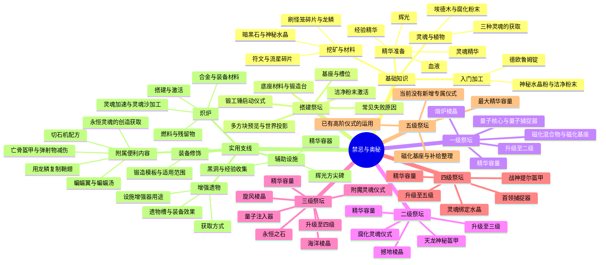

# 《禁忌与奥秘》中文指南结构

内容基线：Minecraft 1.21.1、Forbidden and Arcanus 2.6.1、更好的禁忌与奥秘 0.6.0。所有章节可提前阅读。“祭坛”统一指赫菲斯托斯锻造炉，制物仪式归入首次可用的最低等级；升级仪式归入执行升级的上一等级。

## 条目写法

基础物品说明“哪里获得、如何加工、接下来用在哪里”，首先服务于一级祭坛搭建。每级按目标、容量、首次解锁的物品、下一次升级组织。仪式列出中央物品、基座辅料及数量、四种精华和必要增强器；盔甲同条目内逐件介绍。高阶章节不重复低阶配方，五级介绍储量和已有仪式的运用。

炉体底座：磨制暗黑石 48、镀金錾制磨制暗黑石 9、錾制神秘磨制暗黑石 4；另备锻造台及洁净粉末。原生结构页的建造前中心为锻造台，基座位允许空气或两种基座；完成示意中心匹配全部五种祭坛，显示八个普通基座位置。仪式的实际基座用量按配方，不要求每次填满八个。

炽炉按当前结构需要磨制暗黑石砖 17、磨制暗黑石 8、核心 1；内部中心为空气，核心在侧面中心，投影支持旋转。方尖碑采用神秘磨制暗黑石底座和两层神秘水晶块。

两种新增灵魂仪式、六种灵魂的炽炉倍率、永恒材料保留、遗物和提尔盔甲行为均按当前附属实现。永恒灵魂明确标为创造模式或命令获取。缺少可确认默认生存来源的遗物，正文如实说明，不补造掉落或配方。

## 页面与内容文件

书籍 ID 和数据设置保存在 `data/better_forbidden_arcanus/patchouli_books/forbidden_arcanus/book.json`，名称、外观及无序合成不变。正文位于 `assets/better_forbidden_arcanus/patchouli_books/forbidden_arcanus/en_us/`；延续当前未启用本地化正文的路径设置，目录名不决定正文语言。

普通配方使用原生 `patchouli:crafting`、`patchouli:smelting`；仪式是原 Mod 自定义注册表内容，使用物品页和文字清单。正文面向玩家，不含编辑器或开发操作。跨章节链接在材料和设施需要时引导到对应条目。

多方块页使用 `patchouli:multiblock`。点击书页眼睛按钮，关闭书后查看投影，按游戏提示右击锚定；底座以外无判定要求的位置用任意方块匹配。结构格式、锚点和投影依据 [Patchouli 官方多方块教程](https://vazkiimods.github.io/Patchouli/docs/patchouli-basics/multiblocks/)，材料及激活要求以本机 2.6.1 的原生结构判定为准。

编辑与发布流程见 [GUIDE_EDITOR.md](GUIDE_EDITOR.md) 和 [GIT_GUIDE.md](GIT_GUIDE.md)。重新编辑后运行资源核对及相应开发检查，再构建新 JAR；旧指南资源包可能覆盖新的正文，需关闭或重新导出。
